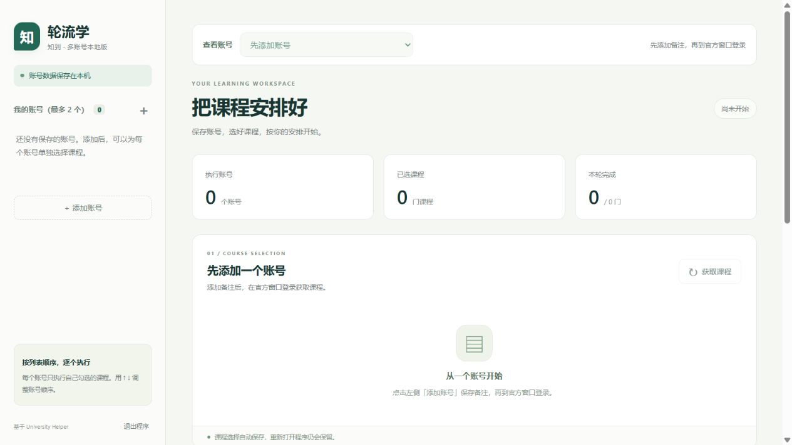

# 轮流学 · 知到双账号免激活版 1.5.1

基于 [sweetcornna/university-helper](https://github.com/sweetcornna/university-helper) 的智慧树课程适配器，新增独立的本地多账号界面。上游基准提交：`e1710e65751e8d98d07aeefcdc9be7b333ec23e1`。

## 1.5.1 请求失败修复

获取课程时，网络超时、连接中断、平台暂时不可用等临时错误会自动额外重试最多 2 次，等待间隔为 1 秒、3 秒。重试只用于读取课程列表，不重复提交播放进度或题目答案。重试期间可以暂停或停止队列。

网络异常不再统一显示为“登录过期”。明确的登录失效、访问受限、频率限制和网络错误分别提示；只有确认会话无效时才要求重新登录。持续失败时保留原有账号、登录状态、课程列表和选择。

运行记录显示重试情况。`data-multi/service.log` 保存失败类别、异常类型、HTTP/平台数字状态码和尝试次数，不记录这次诊断中的密码、Cookie、请求地址、响应正文或原始异常堆栈。真正的断网、平台故障或登录失效仍需要相应处理。



## Windows 使用

Windows 用户请到 [Releases 下载软件包和使用说明](https://github.com/ningmenggeng-svg/zhidao-two-accounts/releases/latest)。下载 Windows ZIP 后完整解压即可运行；GitHub 的“Download ZIP”下载的是源码。

解压完整的 `ZhidaoMulti-Windows.zip`，进入 `ZhidaoMulti` 文件夹，双击 `ZhidaoMulti.exe`。保留同目录的 `_internal` 文件夹，不要只移动 exe。

本版直接进入管理页，无需激活码、邀请码、机器绑定或 API 密钥。最多保存 2 个账号，同时最多运行 2 个账号；删除账号后可以添加其他账号。新用户完整步骤请阅读随包的“先看这里-使用说明.txt”。

1. 点击左侧「添加账号」，只填写方便区分的备注。
2. 点击「账号密码登录」，在独立的 Edge 官方窗口手动输入账号密码、完成协议和验证码。成功后自动保存登录状态并获取课程。扫码登录也可使用。
3. 勾选每个账号的课程。左侧复选框选择本轮执行账号，↑ ↓ 调整顺序。
4. 在「启动与执行」中选择「手动开始」或「每日定时」。定时使用北京时间；定时模式也允许立即手动执行一轮。
5. 选择「按顺序轮流」或「多账号同时执行」。并行模式同时运行账号数可设为 1 或 2，每个账号自己的课程始终按顺序执行。保存运行设置。
6. 点击「开始执行」运行左侧勾选的账号，或选中一个账号后点「只启动当前账号」。运行中可以统一暂停、继续或停止。
7. 「开机自启动」是独立开关：登录 Windows 后在后台打开程序，不弹管理页或 Edge。课程是否自动执行，取决于是否选择了「每日定时」。该开关修改后立即生效，无需点击保存运行设置。
8. 每个账号旁的「删除」按钮会先确认，再删除该账号的本机登录资料、课程列表和课程选择。运行或登录期间暂不可删除。

「把课程安排好」上方的「查看账号」控制下方显示谁的课程，与左侧账号列表同步。切换后会清空上一个账号的搜索条件，并在当前浏览器页刷新后保留选择。是否参与本轮执行，仍由左侧复选框控制。

「轮流执行」标题下方显示本轮整体进度与已完成课程数，并自动刷新。整体百分比取本轮各门课程进度的平均值；课程进度按已完成的视频数更新。

下方每门课程分别显示「课程总体进度」百分比和进度条。等待执行、尚未读取进度的课程显示「待获取」，读取后自动更新。

管理页会分别显示登录窗口是否已打开、网页是否加载完成，以及课程是否读取成功。程序通过它自动弹出的专用登录窗口接收登录状态。已在官方窗口完成登录但管理页尚未显示课程时，可以点「检查登录状态」。网页加载超时会继续等待，不会误报成浏览器未安装。

账号密码登录没有等待时限，窗口会等到登录成功或手动取消。关闭管理网页不会取消登录；关闭管理页的登录对话框、关闭官方窗口或退出后台程序会结束本次登录。

找不到官方窗口时，点击登录对话框里的「显示登录窗口」。程序只对当前账号专用窗口发送恢复、最大化和置前请求。「已连接官方登录窗口」表示程序建立了连接，并不代表已完成账号登录。

## 定时和停止

- 程序运行且电脑开机、联网时，定时才会生效。开机自启动可在界面单独开启；不自动唤醒电脑。
- 只关闭网页，后台程序和定时仍继续。再次双击 exe 可重新打开网页；「退出程序」会停止后台程序。
- 首次启用或修改定时时间，安排在下一次该时刻。程序停机错过原定时间，再打开时会补一次，不会堆积多天任务。已有队列运行时，不另开一轮。
- 顺序模式严格串行；并行模式限制同时运行账号数。停止后等待所有已启动的播放任务退出，才结束本轮。已中断队列不会在重启时擅自续跑。
- 「每门运行上限」按单门课程的本次运行计时，暂停时间不计入。达到上限会停止本门并继续下一门，状态显示「已达上限」，不会当作课程完成。
- 所有账号都未勾选课程时不会执行，也不会默认全选。

## 本地数据

数据位于 exe 旁的 `data-multi` 文件夹，包括账号备注、每账号课程选择、设置和最近一轮记录。管理页不接收、保存或自动填写账号密码。登录 Cookie 用 Fernet 加密，Windows 上的加密密钥再由当前 Windows 用户的 DPAPI 保护，网页接口不返回 Cookie。旧版升级时会移除原来保存在管理程序里的密码，保留备注、课程选择、登录会话和每个账号独立的浏览器资料目录。

登录成功后的状态会跨重启保留，通常不需要每次开机重新登录；知到使会话过期或退出登录后，需要重新在官方窗口验证。更换另一个登录账号时，请新增一条账号备注并在其独立窗口登录。

开机自启动只写入当前 Windows 用户的启动项，指向当前 `ZhidaoMulti.exe --no-browser`。移动程序文件夹后，请重新开启自启动开关。

备份请保留整个数据文件夹；凭据只适用于原 Windows 用户。复制到另一台电脑或另一 Windows 用户后，需要重新添加账号。

服务只监听 `127.0.0.1`，默认网址为 `http://127.0.0.1:18665`。没有账号数据上报功能。登录和课程请求由上游适配器访问知到接口。

## 验证范围

多账号会话隔离、旧数据迁移、账号删除路径保护、重启恢复、课程选择、串行和并行执行、暂停停止、指定账号执行、定时去重及开机启动配置均有自动化测试。测试使用模拟账号和课程，成品不包含测试数据。

账号密码登录需要电脑已安装 Microsoft Edge，使用每个账号单独的浏览器资料目录。账号密码、协议和验证码均由本人在官方页面处理；程序仅接收并加密保存登录状态，之后获取课程和执行任务会优先复用它。登录状态可能过期，届时需要重新打开官方窗口完成登录或验证。

扫码使用知到官方接口，二维码必须由本人在知到 App 扫描并确认。扫码同样保存登录状态，失效后需要重新登录。本地管理程序已移除旧版直接密码登录流程。

本地功能和扫码确认、取消、过期、凭据隔离已有自动化测试；真实课程播放进度和弹题提交仍需本人账号验证。目前适配器主要面向知到共享课程，不保证涵盖所有校内课或 AI 智慧课程。视频弹题处理沿用上游实现，不包含章节考试代答功能。

Windows 成品为本次本地构建，未做代码签名。

## 源码运行和测试

需要 Python 3.11 或更高版本，无需 Node、Docker 或数据库服务器：

```powershell
python -m venv .venv-multi
.venv-multi\Scripts\python.exe -m pip install -r requirements-multi.txt
.venv-multi\Scripts\python.exe backend\run_multi.py
```

安装 `pytest` 和 `httpx` 后执行：

```powershell
.venv-multi\Scripts\python.exe -m pytest multi_account_tests -q
```

`requirements-multi-lock.txt` 记录本次构建全部依赖（包含测试和打包工具）。`build-multi.ps1` 用它重建 Windows 成品。

新增源码位于 `backend/app/local_multi/`，启动入口为 `backend/run_multi.py`。源码包只包含本地多账号版本需要的文件，复用的上游课程模块与 MIT 许可证保留。上游的其他平台模块和宣传素材不在此包中。
